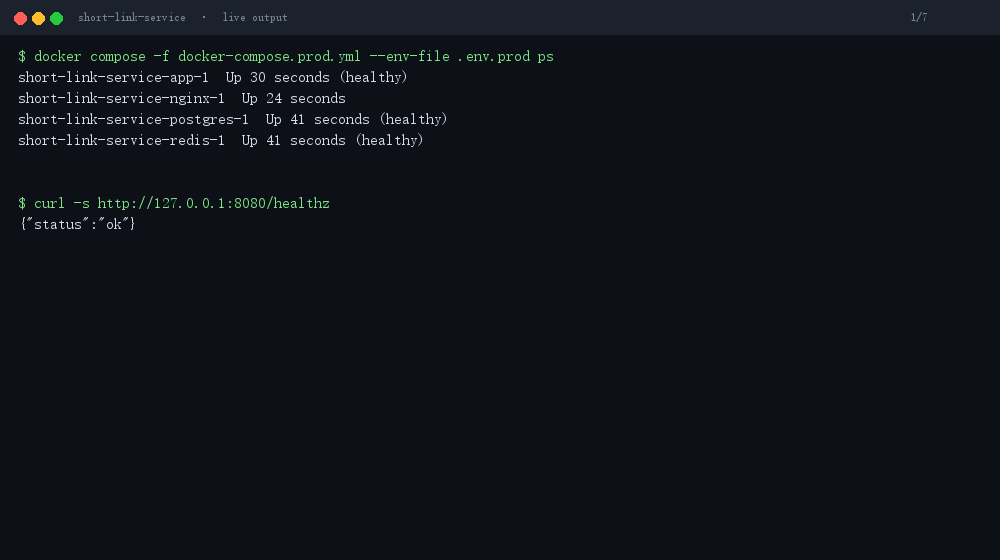

# short-link-service

短链接服务。给一个长网址，换回一个 7 位短码，访问短码 302 跳到原地址。

主要解决两件事：跳转要快（读多写极少，缓存能吃掉绝大部分请求），点击要能统计（但又不能为了统计把跳转拖慢）。

技术栈：FastAPI、SQLAlchemy 2、Alembic、PostgreSQL 16、Redis 7、pytest、Docker Compose、GitHub Actions。




> 上面这段是终端回放，不是录屏：创建 → 302 → 看缓存 → 统计 → 第 601 次 429 → 软删除。
> 内容来自 `docs/demo-transcript.txt`，用 `bench/make_demo_gif.py` 渲染。

## 功能

| 能力 | 说明 |
| --- | --- |
| 创建短链 | 随机 7 位 Base62；也可以指定 4–16 位自定义别名，有保留字黑名单 |
| 跳转 | 302 重定向，读路径先查进程内缓存，再查 Redis，最后才回数据库 |
| 过期 | 创建时可指定 `expires_at`，过期后返回 410 |
| 访问统计 | 按天聚合点击，落库有延迟时接口会合并 Redis 里还没落库的计数 |
| 限流 | 跳转按客户端 IP 600 次/分钟，写接口按 API Key 60 次/分钟，超限 429 |
| 管理 | 分页列表、`PATCH` 改目标地址或过期时间、软删除（跳转 404，统计保留） |
| 可观测 | JSON 结构化日志、`X-Request-ID` 透传、`/metrics` 暴露计数器 |
| 健康检查 | `GET /healthz`，Dockerfile 里也拿它做 HEALTHCHECK |

鉴权只有一个 `X-API-Key` 请求头，没有用户体系（这个刻意的，见文末）。

## 跑起来

```bash
git clone https://github.com/kian399/short-link-service.git
cd short-link-service
cp .env.example .env            # 至少把 API_KEY 改掉
docker compose up -d --build    # postgres + redis + app，迁移随容器启动自动跑
curl http://127.0.0.1:8000/healthz
```

创建一条：

```bash
curl -X POST http://127.0.0.1:8000/api/v1/links \
  -H "X-API-Key: dev-secret-key-123456" \
  -H "Content-Type: application/json" \
  -d '{"original_url":"https://example.com/a/long/path"}'
```

## 接口

| 方法 | 路径 | 用途 | 常见状态码 |
| --- | --- | --- | --- |
| POST | `/api/v1/links` | 创建 | 201 / 401 / 409 / 422 / 429 |
| GET | `/api/v1/links` | 分页列表（不含已删除） | 200 / 401 |
| GET | `/api/v1/links/{code}` | 元信息 | 200 / 401 / 404 |
| PATCH | `/api/v1/links/{code}` | 改目标地址 / 过期时间 | 200 / 401 / 404 / 422 / 429 |
| DELETE | `/api/v1/links/{code}` | 软删除 | 204 / 401 / 404 |
| GET | `/api/v1/links/{code}/stats?days=7` | 按天点击统计 | 200 / 401 / 404 / 422 |
| GET | `/{code}` | 跳转 | 302 / 404 / 410 / 429 |
| GET | `/healthz` | 探活 | 200 |

`/metrics` 是 Prometheus 文本格式，只对容器网段开放（见 `nginx/nginx.conf`）。

## 几个设计上的选择

### 短码

随机 7 位 Base62，62^7 大概 3.5 万亿种，实际量级下撞不上。真要撞了数据库唯一索引会拒掉，接口重试 3 次。

没做发号器：多一个组件就多一份运维，随机码还顺带不可枚举。代价是不可控的字母分布，但这个场景无所谓。

### 缓存

三层：进程内 `TTLCache` 30 秒、Redis 1 小时、最后数据库。

缓存里存的不是纯 URL，是 `{"u": url, "e": expires_at}`。这样命中缓存就能判断过期，不用再回库查一次。Redis 的 TTL 取「配置值」和「距离过期还剩多久」里小的那个，不然给一条 5 分钟后过期的链接缓存一小时，链接过期了缓存还在。

写操作（创建、PATCH、删除）都是先落库再删缓存，没有做双写。跳转是读多写极少的场景，302 容忍几秒不一致，先删缓存再写库反而容易被旧值回填。

不存在的短码会被反复查，所以用一个 60 秒的 `__MISS__` 顶住，防止打穿到数据库。

### 防击穿

缓存刚好失效的瞬间，同一个热点码的并发请求会一起回源。`singleflight` 让一个请求去查，其余等结果。

要说实话：80/20 的常规流量下它一次都没生效过（D 组 `shared` 计数是 0），因为每个冷码的未命中窗口只有几毫秒，200 个并发撞不到同一个码。它真正有用的场景我单独造了（钉死一个码、L1 TTL 调 1 秒、关掉 Redis），回源次数从 604 降到 60。所以它是防击穿组件，不是提吞吐组件。

### 点击统计

跳转路径上只做一次 Redis `INCR`，后台协程每 60 秒把计数批量 UPSERT 进 `link_stats_daily`。

不直接在跳转里 `INSERT` 有两个原因：写放大严重，QPS 上不去；而且缓存命中的请求压根不走回源逻辑，早期版本 20 次点击只记了 1 条。

落库用「读快照 → 写库 → `DECRBY` 扣减」三步，不是 `GETDEL`。第一版就是 `GETDEL`，赶上表还没建，`INSERT` 失败，20 次点击直接蒸发，日志里什么都没有。

4 个 worker 就有 4 个落库协程，所以落库前先抢一把 Redis 锁（`SET NX EX`，55 秒），抢不到就跳过这轮。不然两个进程读到同一批计数，各写一次，点击数直接翻倍。

统计接口会把「已落库的日聚合」和「Redis 里还没落库的今天」加在一起返回，`pending_today` 单独给出来，不然用户点完立刻查会以为没记上。

### 限流

Redis 固定窗口，`INCR` 和 `EXPIRE` 用 Lua 包在一起。分两条命令发的话，中间进程崩了会留下一个永不过期的计数键，那个 IP 就永久被限流了。

跳转按 IP、写接口按 Key。固定窗口的毛病我知道：窗口切换那一瞬间可能放过接近两倍的突发。短链这个场景能接受，要更平滑就得上滑动窗口或令牌桶。

部署到 nginx 后面之后才发现 `request.client.host` 拿到的是 nginx 的容器 IP，600 次/分钟变成整站共享，压测跑到第 601 个请求就开始 429。现在按 `TRUST_PROXY_HEADERS` 开关读 `X-Real-IP`，退而求其次读 `X-Forwarded-For` 的最右一跳。

### 部署

`docker-compose.prod.yml` 里只有 nginx 对外，app / postgres / redis 都在内网，迁移在 app 启动时执行。反代配置在 `nginx/nginx.conf`，包括 upstream keepalive、302 不缓冲、`/healthz` 不记日志。

有个坑写在 `docs/troubleshooting.md` 第 9 条：nginx 启动时会把 upstream 的主机名解析成 IP 并一直用，app 容器重建后 IP 变了，nginx 还在打旧地址，表现就是 502。所以**发完版要重启 nginx**。

## 压测

环境：Ryzen 7 7745HX（8C16T）/ 16GB / Windows 11，PG 和 Redis 跑在 Docker 里，应用单进程 `uvicorn --workers 1`。
数据 10 万条短链，80% 请求打 5% 的热点码。locust 200 并发，3 分钟。

| 组 | 配置 | QPS | P50 | P95 | P99 | 错误 |
| --- | --- | --- | --- | --- | --- | --- |
| A | 纯数据库 | 631 | 310ms | 370ms | 400ms | 0% |
| B | + Redis | 773 | 250ms | 300ms | 320ms | 0% |
| C | + 进程内 L1 | 804 | 240ms | 290ms | 310ms | 0% |
| D | + singleflight | 678 | 280ms | 350ms | 370ms | 0% |
| E | + 埋点 | 635 | 300ms | 380ms | 410ms | 0% |

另外单独做了一次 worker 对照（同一时段、同一份 C 组配置，只改 `--workers`）：1 / 2 / 4 个 worker 分别是 596 / 1223 / 1257 QPS，P50 从 320ms 掉到 67ms。2 个 worker 接近线性，4 个 worker 被压测客户端卡住——应用只吃到 2.45 核，PG 活跃连接全程不超过 3。细节和数据在报告第 7 节。

这组数是 11 月 12 号测的，代码版本 `27a1cee`。11 月 17 号想复跑一次（带限流），结果 PG 容器没起来，A/B/C 三组一千多个请求全失败、延迟 20 多秒，整批数据作废，还把 C 组原来的 csv 覆盖了。所以表里还是那批老数据，复跑待补。

三个我现在还认的结论：

1. 这批改动里 Redis 是唯一的大头。QPS 631 → 773，回源 PG 从 593 次/秒掉到 150 次/秒（这个数字来自进程内计数器，比 QPS 可靠）。
2. 第二道瓶颈是单进程。同一份配置开 4 个 worker，QPS 直接到 1538。再往上加不动，是压测机自己先撑不住（locust 和应用抢同一台机器的 CPU）。
3. D 和 E 比 C 低的那点，我不敢单独归因。同配置重复跑自己就能差 12%，把噪声当结论是压测最容易犯的错。

方法、逐组归因、以及这份数据的可信度边界在 [docs/benchmark.md](docs/benchmark.md)，踩过的坑在 [docs/troubleshooting.md](docs/troubleshooting.md)。

## 局限（Honest Limitations）

这个项目停在这里，不打算再加功能。下面几条是我知道但没做的，面试问「还有什么不足」可以直接照着说：

- 单机、单 API Key、没有多租户。所有链接属于同一个人，没有「用户—链接」这层关系，也就没有配额和权限。
- 限流是单机固定窗口，依赖一个 Redis 实例。窗口切换那一瞬间能放过接近两倍突发；Redis 挂了限流直接 500，应该降级成放行加告警。
- L1 是进程内缓存，多 worker 下改删只失效当前进程，别的 worker 最多跳 30 秒旧地址。跨机部署时这层要么关掉，要么上广播。
- 没上云验证过。压测是 loopback，云上最便宜的 2C2G 机器能跑到多少我不知道，带宽、RTT、TLS 都会吃掉一块。
- 没有 HTTPS、域名、监控告警，也没有灰度发布。这些偏运维，不打算在这个项目里补。
- 数据量只到 10 万级。再往上是分库分表和布隆过滤器的事，那是另一个量级的问题。

## 测试

```bash
uv run pytest --cov=app --cov-report=term-missing
```

当前 72 个用例，覆盖率 90%。数据库用事务回滚隔离，Redis 用 fakeredis（限流的 Lua 脚本靠 lupa 跑）。

CI 里是真实的 PostgreSQL 16 和 Redis 7 服务容器，跑 ruff、black、alembic、pytest。

## 目录

```
app/
  main.py          应用入口、异常处理、埋点落库的后台任务
  config.py        pydantic-settings 配置（缓存/限流/埋点都能用环境变量关掉）
  db.py            engine 和 session，连接池按 worker 数均分
  metrics.py       手写的 Prometheus 文本指标
  middleware/      Request-ID、请求指标、限流
  services/        短码生成、两层缓存、singleflight、统计
  api/v1/          增删改查、统计、跳转
alembic/           5 个版本的迁移
bench/             seed、locust 脚本、六组压测编排、RUNBOOK
docs/              压测报告、踩坑记录、演示脚本、面试问答
nginx/             生产反代配置
tests/             72 个用例
```

## 进度

- [x] M0 核心链路（10-24）
- [x] M1 工程化：Docker / CI / 测试 / 日志（10-24）
- [x] M2 性能：L1、singleflight、压测（11-13）
- [x] M3 功能：统计接口、限流、分页 / PATCH / 软删除（11-15）
- [x] M4 交付：生产编排、演示脚本、压测数据核对（11-19）
- [x] v1.0.0 冻结（11-19）：环境体检脚本、1/2/4 worker 对照、局限写清楚
- [ ] 买台云服务器真的部一次（代码就绪，差钱和域名）

## 明确不做

用户体系和多租户、前端页面、实时大屏、布隆过滤器（长尾回源还能再挡一层，但当前数据量用不上）。

## 文档与踩坑台账

- [压测报告](docs/benchmark.md)：五组对比、1/2/4 worker 对照、数据可信度边界
- [踩坑台账](docs/troubleshooting.md)：10 条真实踩过的坑，从镜像不重建到 nginx 502
- [面试演示脚本](docs/DEMO.md)
- [面试问答（含网络层）](docs/INTERVIEW.md)
